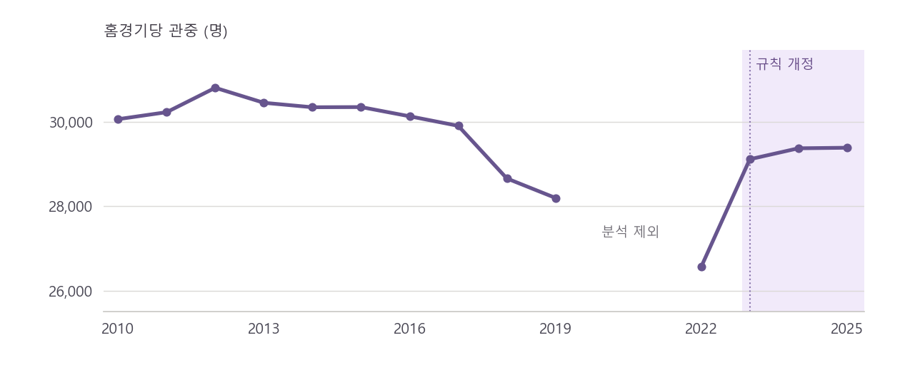

# MLB 규칙 분석 · 규칙이 관중을 불렀는가?

**2023년 MLB 규칙 개정 전후의 경기당 관중 변화**

[분석 자세히 보기](https://dlrbehs.github.io/mlb.html) · [코드와 실행 결과](https://dlrbehs.github.io/notebook.html) · [실행용 노트북](mlb-analysis.ipynb)

> 2023년에 경기당 관중이 증가한 구단은 2022년을 기준으로 26개, 2019년을 기준으로 15개였다. 두 기준에서 같은 30개 구단을 짝지어 비교했다.

---

[이규돈의 전체 포트폴리오](https://dlrbehs.github.io/)

## 1. 문제 정의

### 출발점

2024년 6월, 토론토에서 블루제이스 경기를 직관했다. 경기는 **2시간 54분** 걸렸다. "요즘 MLB 경기가 짧아졌다"는 말을 들었던 터라 평균 경기 시간을 찾아봤다.

| 연도 | 9이닝 평균 경기시간 |
|---|---|
| 2021 | 3:10 (역대 최장) |
| 2023 (규칙 개정) | 2:40 |
| 2024 | 2:36 (40년 만 최단) |

2023년에는 **피치 타이머, 투구판 이탈 제한, 수비 시프트 제한, 베이스 확대**가 함께 시행됐다. 2024년 평균 경기 시간은 2021년보다 34분 짧았다. [MLB 경기 시간 자료](https://www.mlb.com/news/mlb-average-game-time-under-three-hours-third-straight-year)

### 의문이 생긴 지점

MLB는 2023년 총관중이 전년보다 **9.6%** 늘었다고 발표했다. 공식 경기당 관중 증가율은 **9.1%**였고, MLB는 30년 기록을 비교할 때 코로나19의 영향을 받은 시즌을 제외했다고 명시했다. 내가 궁금했던 것은 회복기의 2022년을 기준으로 산출한 증가폭이 다른 기준에서도 유지되는지였다. [MLB 보도자료, 2023년 10월 2일](https://www.mlb.com/press-release/press-release-mlb-attendance-surpasses-70-million-and-records-largest-percentage)

2022년은 미국이 아직 코로나에서 회복하던 시기였다.

| 시점 | 상황 |
|---|---|
| 2022-01 | 오미크론 정점 (미국 확진의 99.5%) |
| 2022-02-25 | CDC 마스크 권고 완화 (인구 약 70%) |
| **2022-05~06** | **재확산 — 하루 10만 명 재돌파, CDC 마스크 재권고** |
| 2022-09-19 | 바이든 "팬데믹은 끝났다" (인터뷰 발언) |
| 2023-05-11 | 연방 공중보건 비상사태 공식 종료 |

MLB 정규시즌은 4월 초~10월 초다. **재확산이 시즌 한복판에 있었고, 사회적 분위기 전환은 시즌이 끝날 무렵이었다.**

### 연구 질문

> **규칙 개정 이후 관중의 증가폭과 증가 구단 수는 2022년, 2019년, 장기 추세를 기준으로 삼았을 때 각각 어떻게 달라지는가?**

### 왜 의미 있는 질문인가

이 문제는 야구에 국한되지 않는다. **외생 충격(감염병·재난·경제위기) 직후에 시행된 정책은 회복 효과와 혼동되기 쉽다.** 관광, 고용, 소상공인 지원 정책이 모두 같은 구조를 갖는다.

"전년 대비 몇 % 증가"라는 흔한 성과 지표가 **언제 신뢰할 수 없는지**를 구체적 사례로 보여주는 것이 이 분석의 목적이다.

---

## 2. 데이터

### 출처

| 항목 | 내용 |
|---|---|
| 데이터셋 | Lahman Baseball Database, 2025 버전 |
| 제공 | SABR (Society for American Baseball Research) |
| 수록 기간 | 1871 ~ 2025 시즌 |
| 형식 | Comma-delimited (CSV), 무료 공개 |
| 출처 | [SABR 배포 페이지](https://sabr.org/lahman-database/) · [실행에 사용한 고정 버전 CSV](https://raw.githubusercontent.com/corbtastik/lahman-baseball-db/b5e7327707fff91ff3bdcbe1f6892c8c5015cf1d/Teams.csv) |
| 사용 테이블 | `Teams.csv` |

**보조 자료** (배경 정보로만 인용)
- MLB 공식 보도자료 (2022-09-09) — 규칙 개정 내용
- MLB 공식 보도자료 (2023-10-02) — 관중·경기 시간 통계

### 규모

| 구분 | 행 | 열 |
|---|---|---|
| 원본 | 3,614 | 48 |
| 필요 컬럼 추출 | 3,614 | **11** |
| AL·NL, 2010년 이후 | **480** | 11 |

분석 기간을 2010년 이후로 잡은 이유 — 코로나 이전 10년을 확보하기 위해서이고, 1998년 이후 30개 구단 체제가 유지되어 구단 수 변동이 없다.

### 주요 변수

| 컬럼 | 설명 | 용도 |
|---|---|---|
| `yearID` | 연도 | 시계열 축 |
| `franchID` | **프랜차이즈 ID** | 연도 간 구단 매칭 |
| `teamID` | 팀 ID | 참고 |
| `attendance` | 총 관중 수 | **핵심 지표 분자** |
| `Ghome` | 홈경기 수 | **핵심 지표 분모** |
| `W`, `L` | 승, 패 | 원자료 식별용으로 보존. 팀 성적은 모형에 포함하지 않음 |
| `lgID`, `name`, `G`, `park` | 리그·팀명·총경기·구장 | 식별 |

### 파생 지표

```
경기당 관중 = attendance / Ghome
```

홈경기 수가 구단마다 다르므로 총 관중으로 비교하면 안 된다. 인구 대비 범죄율을 쓰는 것과 같은 정규화다.

### 데이터 품질 진단

**① 결측이 아닌 0**

2010년 이후 구간에 결측치(`NaN`)는 없었다. 그러나 **2020년 관중이 30개 구단 전부 0**이었다. 무관중 경기였기 때문이다.

`isna()`로는 잡히지 않아 `attendance == 0` 조건으로 따로 확인해야 했다.

**② 식별자 변경**

2025 시즌 오클랜드 애슬레틱스의 `teamID`가 **OAK → ATH**로 바뀌었다(연고 이전).

2019→2023과 2022→2023은 두 식별자 모두 30개 구단이 매칭됐다. **2022→2025는 `teamID`로 29개, `franchID`로 30개**였다. 세 비교에 같은 구단을 포함하도록 프랜차이즈 식별자로 통일했다. [구단 매칭 출력](https://dlrbehs.github.io/notebook.html#identifiers)

**③ 제외한 시즌**

| 연도 | 경기당 관중 | 제외 사유 |
|---|---|---|
| 2020 | **0** | 무관중, 60경기 단축 |
| 2021 | 18,652 | 시즌 초 입장 인원 제한 |

두 해 모두 **관중 수가 팬의 선택이 아니라 행정 규제로 결정**되었다. 데이터 생성 과정이 다르므로 제외했다.

### 교차검증

시즌 총관중 증가율을 재계산하고, 총관중이 증가한 구단 수도 대조했다. MLB 공식 2023년 경기당 평균은 **29,295명**이다. 이 분석은 Lahman 총관중 70,747,365명을 총홈경기 2,430경기로 나눈 **29,114명**을 사용한다. [공식 발표](https://www.mlb.com/press-release/press-release-mlb-attendance-surpasses-70-million-and-records-largest-percentage) · [집계 결과](https://dlrbehs.github.io/notebook.html#total)

| | MLB 공식 | 본 분석 계산 |
|---|---|---|
| 총관중 2022→2023 | +9.6% | **+9.59%** |
| 증가 구단 수 | 26/30 | **26/30** |

---

## 3. 분석 과정

### 전체 흐름

```
① MLB 발표 재현          → +9.6% 확인
② 의문: 2022년이 기준으로 타당한가
③ 2019년 대비 재계산      → +3.2%
④ 의문: 3%가 우연은 아닌가
⑤ 구단별 t-검정          → p = 0.379, 유의하지 않음  ← 막힘
⑥ 추이 그래프 확인        → 2012년 고점에서 2019년까지 8.5% 하락
⑦ 의문: 2019년도 하락 중이던 해인데 기준으로 타당한가
⑧ 회귀분석으로 추세 통제   → +2,228명, p = 0.007
```

### 분석 질문과 검정

| 질문 | 검정 방법 |
|---|---|
| 개정 전후의 관중 차이는 비교 기준에 따라 얼마나 달라지는가? | 2019→2023 및 2022→2023 구단별 대응표본 t 검정, 리그 수준 변화 회귀 |
| 2025년에도 2022년보다 관중이 많은가? | 2022→2025 구단별 대응표본 t 검정 |
| 2023년의 증가가 여러 구단에 나타났는가? | 기준연도별 증가 구단 수, 양측 부호검정, 같은 극단값 규칙을 적용한 보조 검정 |

### 방법 선택 근거

#### ① 왜 대응표본 t-검정인가

같은 구단을 두 시점에 관찰한 자료다.

| 설계 | 문제 |
|---|---|
| 독립표본 | 양키스(4.7만)와 말린스(1.4만)의 **규모 차이가 오차에 섞여** 검정력 급락 |
| **대응표본** | 각 구단의 **변화량**만 보므로 규모 차이가 상쇄됨 ✅ |

검정 전 **Shapiro-Wilk**로 정규성을 확인하고(p=0.2389), 차이값의 대칭성을 전제로 하는 **Wilcoxon 부호순위 검정**도 함께 보고했다.

**Cohen's d**를 함께 보고한 이유 — p값은 표본 수에 좌우되므로 "차이가 있는가"만 말하고 "얼마나 큰가"는 말하지 않는다.

#### ② 왜 중단시계열 회귀(ITS)인가

| 대안 | 왜 쓰지 않았나 |
|---|---|
| 단순 전후 비교 | 개입 전 **하락 추세**를 무시 → 효과가 과소평가되거나 부호가 뒤집힘 |
| 전년 대비 | 비교 기준 한 점이 비정상이면 결론이 통째로 왜곡됨 (MLB 방식의 문제) |
| 이중차분(DiD) | **대조군 필요** — 규칙을 바꾸지 않은 유사 리그가 없음 |
| **중단시계열(ITS)** | **대조군 없이 단일 시계열에서 개입 효과를 추정하는 표준 방법** ✅ |

ITS는 의학·공중보건 정책 평가에서 쓰이는 준실험 설계다. 금연법 시행 후 심장질환 발생률 같은 연구가 같은 방식을 쓴다.

#### ③ 모형 설정

```
att_pg = β₀ + β₁·time + β₂·post + ε
```

| 변수 | 값 | 역할 |
|---|---|---|
| `time` | 연도 − 2010 (0, 1, 2, … 15) | 선의 **기울기** |
| `post` | 2023년 이후 1, 이전 0 | 선의 **점프** |

`time`을 순번이 아닌 **실제 경과 연수**로 둔 것이 중요하다. 2020·2021년을 제외했지만 시간은 흘렀으므로, 2022년의 `time`은 10이 아니라 **12**다.

#### ④ 기울기 변화 변수를 뺀 이유

개입 후 기울기 변화를 재는 `time_post`를 추가한 3변수 모형도 시도했다.

```
time        -295.1   p = 0.0006  ✅
post       +1421.3   p = 0.2417  ❌
time_post   +431.3   p = 0.3981  ❌
```

기울기 변화까지 허용하면 두 계수의 추정이 불안정해진다. 여기서 `time_post = post × (yearID − 2022)`이므로 2023년의 적합선 간격은 이 모형의 `post + time_post` 계수 합이다.

| 진단 | 값 |
|---|---|
| `post` ↔ `time_post` 상관 | **0.908** |
| 개입 후 관측치 수 | **3개** |

두 변수가 2022년까지 모두 0이고 마지막 3개 행만 다르다. 개정 후 세 점만으로 수준 변화와 기울기 변화를 각각 정밀하게 추정하기 어렵다.

**AIC 기준으로도 축소 모형이 우수**하여(224.9 vs 225.9) `time_post`를 제외했다. 다만 AIC 차이가 1.0으로 작으므로, 주 근거는 다중공선성이다.

---

## 4. 결과

### 4-1. 리그 전체 경기당 관중



| 연도 | 경기당 관중 | 2019 대비 |
|---|---|---|
| 2010 | 30,063 | +6.6% |
| **2012** | **30,806** | +9.2% (구간 최고) |
| 2015 | 30,350 | +7.6% |
| 2017 | 29,906 | +6.1% |
| 2019 | **28,199** | 기준 |
| 2020 | 0 (무관중) | 제외 |
| 2021 | 18,652 | -33.9% |
| **2022** | **26,567** | **-5.8%** |
| **2023** | **29,114** | **+3.2%** |
| 2024 | 29,374 | +4.2% |
| 2025 | 29,387 | +4.2% |

**두 가지 사실이 동시에 성립한다.**

1. **2012~2019년 7년간 8.5% 하락** — 규칙 개정 전 이미 장기 하락 추세
2. **2022년은 입장 제한이 해제됐음에도 2019년 대비 -5.8%**

### 4-2. 대응표본 t-검정

| 구단별 경기당 관중 | 2019→2023 | 2022→2023 | 2022→2025 |
|---|---:|---:|---:|
| 매칭된 구단 | 30 | 30 | 30 |
| 평균 차이 | +918명 | +2,551명 | +2,824명 |
| 관중 증가 구단 | 15/30 | 26/30 | 22/30 |
| Shapiro–Wilk p | 0.2389 | 0.7557 | 0.3987 |
| 대응표본 t | 0.893 | 4.493 | 2.807 |
| 양측 p | 0.379180 | 0.000103 | 0.008850 |
| Wilcoxon 양측 p | 0.655438 | 0.000044 | 0.003223 |
| 짝지은 효과크기 Cohen’s dz | 0.163 | 0.820 | 0.512 |

2019년과 비교하면 15개 구단에서 늘고 15개 구단에서 줄었다. 평균 차이 +918명은 5% 수준에서 유의하지 않았다. 2025년에는 2022년보다 경기당 평균 2,824명 많았다. 두 해의 직접 비교만으로 규칙 개정의 인과효과나 중간 시즌의 지속성을 판정할 수는 없다. [세 검정의 전체 출력](https://dlrbehs.github.io/notebook.html#paired)

#### 증가 구단 분포와 극단값 민감도

구단별 변화량을 기준으로 두 비교에 같은 규칙을 적용했다. 변화량이 [Q1 − 1.5×IQR, Q3 + 1.5×IQR] 범위 밖인 구단을 제외한 뒤 평균 차이를 다시 검정했다. 증가 구단 비율은 변화량이 0인 구단을 제외한 양측 이항 부호검정으로 50%와 비교했다.

| 기준연도→2023 | 변화량 중앙값 | 부호검정 p | 제외 구단 | 남은 구단 수 | 제외 후 평균 차이 | 제외 후 양측 t 검정 p |
|---|---:|---:|---|---:|---:|---:|
| 2019→2023 | +584명 | 1.000000 | TOR | 29 | +409명 | 0.661845 |
| 2022→2023 | +2,045명 | 0.000059 | 없음 | 30 | +2,551명 | 0.000103 |

전체 30개 구단을 주 결과로 삼았다. 토론토를 제외하면 2019년 대비 평균 증가분이 +918명에서 +409명으로 작아진다. 2022년 대비 증가는 여러 구단에 걸쳐 나타났고, 극단값 기준에 해당하는 구단이 없었다. [경계값과 재검정 출력](https://dlrbehs.github.io/notebook.html#spread)

### 4-3. 중단시계열 회귀

```
y = 31,106 − 288.7 × time + 2,228 × post
```

| 계수 | 값 | p |
|---|---|---|
| Intercept | 31,105.9 | 0.0000 |
| **time** | **−288.7** | **0.0004** |
| **post** | **+2,227.9** | **0.0073** |

| 지표 | 값 |
|---|---|
| R² | 0.695 |
| post 95% 신뢰구간 | **[735, 3,721]** |
| Durbin-Watson | 0.667 |
| HAC 보정 후 post p | **0.0018** (Bartlett, 관측 순서 시차 1, 소표본 보정 해제, 정규근사) |

**해석**

공통 기울기는 연간 **−288.7명**이었고, 2023년부터 관중 수준이 경기당 **2,228명 높게** 추정됐다. HAC는 같은 계수의 표준오차를 다시 계산한다. 분석에 포함한 14개 관측의 순서를 사용하므로 빠진 두 시즌을 사이에 둔 2019년과 2022년도 이웃한 관측으로 처리한다. [회귀와 잔차 진단](https://dlrbehs.github.io/notebook.html#diagnostics)

2023년을 계산하면 (time = 13):

| | 계산 | 결과 |
|---|---|---|
| 수준 변화 없이 추세를 연장 (post=0) | 반올림 전 계수로 예측 | **27,352** |
| 수준 변화 반영 (post=1) | 같은 추세에 post 계수 추가 | **29,580** |
| **차이** | | **2,228** |

### 4-4. ⭐ 추세 통제의 결정적 효과

`time` 변수 하나를 빼면 결과의 **부호가 뒤집힌다.**

| 모형 | 비교 기준 | 추정 효과 |
|---|---|---|
| `att_pg ~ post` | 개입 전 **평균** (수평선) | **−318명** |
| `att_pg ~ time + post` | 개입 전 **추세** (하강선) | **+2,228명** |

관중이 계속 줄고 있었으므로, "개입이 없었을 때의 2023년"은 과거 평균보다 낮아야 한다. 수평선을 기준으로 삼는 것은 **"떨어지지 않았을 것"이라고 가정하는 것**과 같다.

### 4-5. 세 가지 기준, 세 가지 결론

| 비교 기준 | 증가분 | p값 | 판정 |
|---|---|---|---|
| 2022년 (구단별 경기당 관중) | +2,551명 | < 0.001 | **유의** |
| 2019년 (코로나 직전) | +918명 | 0.379 | **유의하지 않음** |
| 개입 전 추세 (회귀분석) | +2,228명 | 0.007 | **유의** |

두 시즌의 구단별 차이와 14개 시즌의 리그 수준 차이는 분석 단위가 다르다. 추정치와 함께 비교 대상과 집계 방식을 표시했다.

| 기준 | 문제 |
|---|---|
| 2022년 | 코로나 회복이 덜 된 해 → **증가폭 과대평가** |
| 2019년 | 장기 하락의 한 시점 → **4년간 예상 감소분 미반영** |
| **추세** | 특정 연도를 고르지 않음 → **"줄어야 할 때 늘었다"를 측정** |

---

## 5. 인사이트

### 5-1. 분석이 말할 수 있는 것과 없는 것

| 말할 수 있는 것 | 말할 수 없는 것 |
|---|---|
| 개입 시점에 통계적으로 유의한 수준 상승이 있었다 | 그 상승이 **규칙 때문이다** |
| 개입 전 하락 추세가 존재했다 | 네 규칙 중 **무엇이** 효과를 냈는가 |
| 상승 폭은 약 2,228명 | 다른 동시 요인의 기여도 |

**서술 원칙**

| ❌ | ✅ |
|---|---|
| 규칙이 관중을 늘렸다 | **규칙 개정 시점에 통계적으로 유의한 수준 상승이 관찰되었다** |

### 5-2. 의사결정에 쓸 수 있는 지점

#### ① 성과 공표 기준 전환

| 지표 | 값 | 성격 |
|---|---|---|
| 전년 대비 (현행) | +9.6% | **기저효과 포함** |
| 2019년 대비 | +3.2% | 코로나 이전 회복 여부 |
| 추세 대비 | +2,228명 | 하락 추세 통제 |

전년 대비는 비교 대상 연도가 비정상일 때 과대평가된다. **코로나 이전 기준선 대비 병기**가 정직한 공표 방식이다.

#### ② 개별 구단 평가

구단 성과도 **추세 대비**로 평가해야 과대·과소평가를 피할 수 있다. 하락 국면에서 "유지"만 해도 성과인데, 전년 대비로는 "변화 없음"으로 잡힌다.

#### ③ 규칙 추가 개정의 판단 근거

2024년 피치 타이머가 20초→18초로 추가 단축되었다. **같은 설계로 효과를 검증**할 수 있으며, 리그의 추가 개정 결정에 근거를 제공한다.

### 5-3. 야구를 넘어서는 함의 ⭐

**이 분석의 핵심 기여는 "관중이 늘었다"가 아니라 "무엇과 비교할 것인가"라는 질문이다.**

| 원칙 | 내용 |
|---|---|
| **기준선 명시** | 왜 그 해를 기준으로 골랐는지 먼저 밝힐 것 |
| **추세 통제** | 하락 중이었다면 "유지"도 성과다 |
| **회복과 효과 분리** | 외생 충격 직후 정책은 회복 효과와 혼동된다 |

**적용 가능 분야**

| 분야 | 같은 구조의 문제 |
|---|---|
| 관광 정책 | 코로나 후 관광객 증가가 정책 효과인가 회복인가 |
| 고용 정책 | 취업률 상승이 정책 효과인가 |
| 소상공인 지원 | 매출 회복이 지원금 덕인가 |
| 교육 | 학력 회복이 프로그램 효과인가 |

**본 분석에서 기준을 바꾸니 −318명과 +2,228명이 나왔다. 방법 선택이 곧 결론이다.**

### 5-4. KBO 적용

한국도 피치클락과 ABS를 도입했으므로 동일한 분석 설계를 적용할 수 있다. 단, KBO는 코로나 이후 관중이 급증(2024년 첫 1,000만 관중 돌파)하여 배경이 다르므로 별도 해석이 필요하다.

---

## 6. 한계와 개선점

### 6-1. 데이터의 한계

| 한계 | 내용 |
|---|---|
| **지표의 성격** | MLB 관중 집계는 **판매 티켓 기준**으로, 실제 입장객과 다를 수 있다. 경기 시간 단축이 관람 경험에 미친 영향을 보려면 실제 입장객이 적합하다 |
| **구장 수용인원 미반영** | 좌석 점유율을 산출하지 못해 **천장 효과**를 통제하지 못했다. LAD(47,672명), SLN(40,995명)처럼 포화 상태인 구단은 증가 여력 자체가 제한된다 |
| **관측 공백** | 2020·2021년 두 시즌의 관측값을 제외해 2019년과 2022년 사이에 3년의 시간 간격이 있다. 회귀모형은 해당 기간에도 기존 추세가 유지되었다고 가정하며, **이 가정은 검증 불가능하다** |

### 6-2. 분석의 한계

| 한계 | 내용 |
|---|---|
| **설정 민감성** ⭐ | 2022년을 제외하면 **+1,214명, p = 0.102**로 유의수준에 미달. 결론이 2022년을 정상 시즌으로 보는 전제에 의존한다 |
| **대조군 부재** | 규칙을 개정하지 않은 유사 리그가 없어 인과관계 확정 불가. 2023년에 규칙 외 다른 요인이 있었다면 구분할 수 없다 |
| **개입 분리 불가** | 네 규칙이 **같은 날 동시 시행**되어 개별 기여도를 분리할 수 없다. 본 분석의 '개입'은 규칙 묶음 전체를 의미한다 |
| **외부 요인 미통제** | 팀 성적과 티켓 가격, 스타 선수 등장, 마케팅 정책, 지역 경제 등은 모형에서 통제하지 못했다 |
| **추정 정밀도** | 관측치 14개, 95% 신뢰구간 [735, 3,721]로 넓다. 주 모형의 수준 차이 추정에는 불확실성이 있다 |
| **기울기 변화 미검증** | 개입 후 관측치 3개, 변수 간 상관 0.908. 기울기 변화의 추정 정밀도가 낮다(p=0.398) |
| **자기상관** | Durbin-Watson 0.667로 양의 자기상관 가능성이 있다. HAC 결과는 소표본에서 보조 분석으로 해석한다 |

### 6-3. 다음에 보완할 것

| 우선순위 | 개선 방향 | 기대 효과 |
|---|---|---|
| **1** | **구장 수용인원 수집 → 좌석 점유율 산출** | 천장 효과 통제, 소규모 시장 구단의 성과 정당 평가 |
| **2** | **구단 패널 고정효과 모형** (30팀 × 14년 = 420 관측치) | 연도 단위 n=14의 검정력 부족 해소 |
| **3** | 2026~2027 시즌 데이터 확보 후 **기울기 변화 재검정** | 개정 후 기울기의 추정 정밀도 점검 |
| **4** | 2026년 ABS 도입을 **두 번째 개입 시점**으로 분석 | 동일 설계의 재현성 확인 |
| **5** | KBO 데이터 확보 후 **양 리그 비교** | 유사 대조군 역할 가능성 |

### 6-4. 분석 과정에서 얻은 교훈

**① 식별자는 고정이라고 가정하면 안 된다**

2022년과 2025년 자료를 결합할 때 구단 코드를 쓰면 29개, 프랜차이즈 식별자를 쓰면 30개가 남았다. 구단 개명·연고 이전, 기업 합병, 행정구역 개편 등에서 항상 발생한다. `dropna()` 후 행 수를 반드시 확인해야 한다.

**② 0은 결측이 아니다**

2020년 무관중은 `isna()`로 잡히지 않았다. "결측치 없음"이 "데이터가 깨끗함"을 뜻하지 않는다.

**③ 비유의를 효과 부재로 읽으면 안 된다**

2019년 기준 검정(p=0.379)과 기울기 변화 추정(p=0.398)은 성격이 다르다. 전자는 구단 간 변화량의 분산에 비해 평균 차이가 작았고, 후자는 개정 이후 관측이 세 시즌에 그쳤다. 두 결과 모두 차이의 크기와 추정 정밀도를 함께 해석해야 한다.

**④ 유리한 설정만 보고하면 체리피킹이다**

2022년 포함 여부에 따라 p값이 0.007과 0.102로 갈린다. 두 결과를 모두 제시하고 주 모형을 명시하는 것이 정직한 보고다.

---

## 재현 방법

1. [실행용 노트북](mlb-analysis.ipynb)을 내려받아 Jupyter에서 연다.
2. pandas, NumPy, SciPy, statsmodels, Matplotlib, ipykernel을 설치하고 첫 셀부터 차례로 실행한다.
3. 같은 폴더에 2025년판 `Teams.csv`가 있으면 이를 읽는다. 파일이 없으면 노트북에 고정한 버전의 CSV를 내려받는다. 실행에 사용한 파일의 SHA-256은 두 번째 코드 셀에 출력한다.

## 기술 스택

```
Python 3.13 (이번 재실행 환경)
├── pandas, numpy          데이터 처리
├── scipy.stats            t-검정, Shapiro-Wilk, Wilcoxon
├── statsmodels            OLS 회귀, HAC 표준오차, Durbin-Watson
└── matplotlib             시각화
```

---

## 결론

> MLB 관중은 2012년부터 2019년까지 7년간 8.5% 감소하는 하락 추세에 있었다. 코로나 입장 제한이 해제된 2022년에도 2019년 수준을 5.8% 밑돌았다.
>
> 2023년 규칙 개정 이후 경기당 관중은 29,114명으로 2019년 수준을 3.2% 상회했다. 다만 2019년과의 직접 비교는 통계적으로 유의하지 않았으며(p=0.379), **개입 전 하락 추세를 통제한 회귀분석에서 경기당 2,228명의 유의한 수준 상승이 확인되었다**(p=0.007, HAC 보정 p=0.002).
>
> 2022년을 제외하면 수준 차이는 **+1,214명(p=0.102)**이다. 대조 리그가 없고 2022년 포함 여부에 따라 추정치가 달라져, 관중 증가에서 규칙 개정의 몫을 분리할 수 없다.
>
> **핵심 발견은 효과의 크기가 아니라, 비교 기준이 결론을 만든다는 사실이다.** 추세를 통제하지 않은 모형에서는 −318명, 통제한 모형에서는 +2,228명으로 부호가 뒤집혔다.
